# Guía rápida — Simulador «¿qué pasaría si…?» en la PC

Todo ocurre **sobre el mapa**. El panel lateral solo aparece si pides las cifras.
Funciona únicamente en la instalación local (no en la versión web en la nube).

## Antes de empezar

1. Doble clic en **`INICIAR-MAPA.bat`**. Se abre una ventana negra (el servidor) y el navegador en `http://127.0.0.1:8360/`.
2. Si ya tenías el navegador abierto con el mapa, recarga con **Ctrl + F5** para ver la última versión.
3. Opcional, para el modo **Capacidad**: `pip install -r requirements-simulation.txt` y vuelve a abrir `INICIAR-MAPA.bat`.

## Paso a paso

### 1 · Entra al simulador
Pulsa **SIMULAR** en la barra de modos (arriba a la derecha).

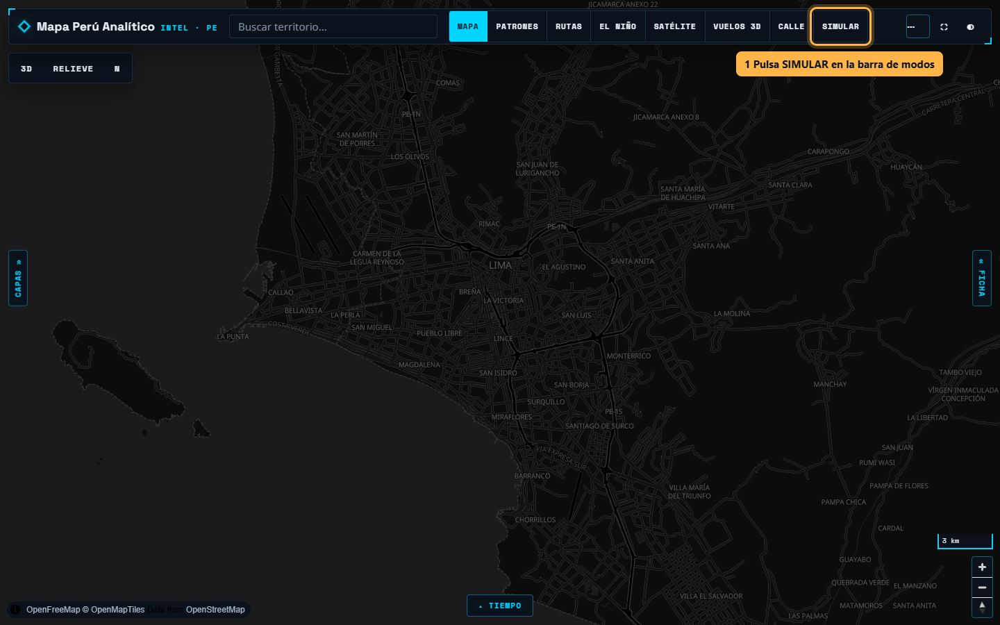

### 2 · Haz clic donde quieras estudiar
Un clic en cualquier punto del mapa dibuja la zona y la simulación arranca sola. Aparecen las sedes cercanas
(puntos blancos) sin pedirlas; las que están fuera del círculo se ven atenuadas porque también pueden ser las más cercanas.

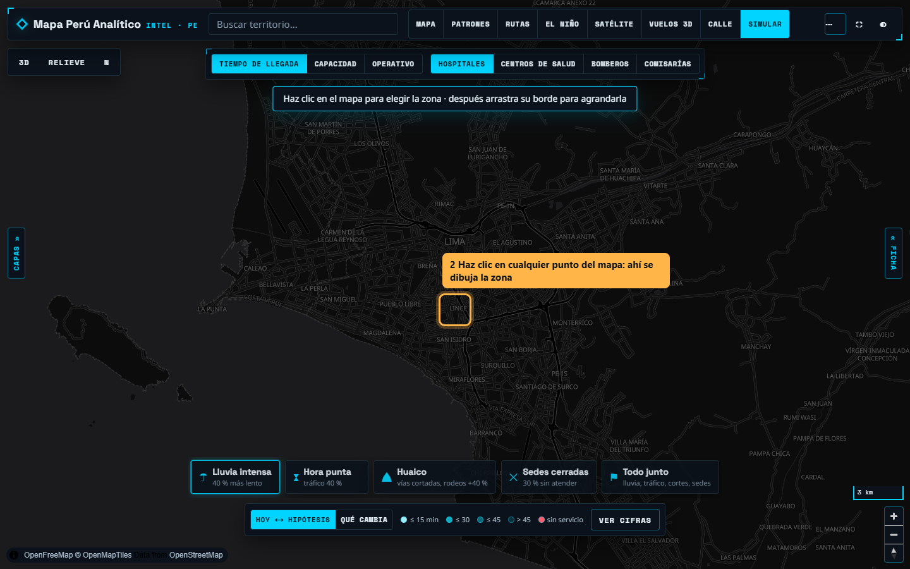

### 3 · Ajusta el tamaño de la zona
Arrastra el **punto del borde** para cambiar el radio (de 1 a 30 km; se muestra al lado). Arrastra el **centro** para moverla.
Al soltar, se recalcula. Con el teclado: selecciona el punto del borde (Tab) y usa las flechas.

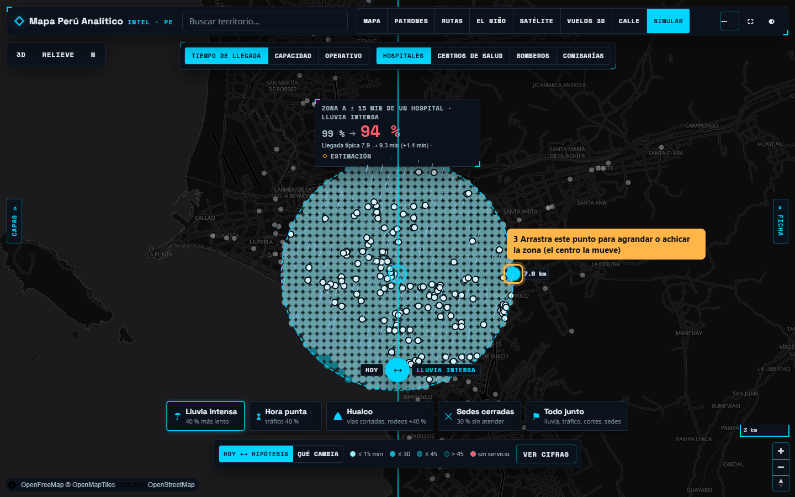

### 4 · Lee el resultado sobre la zona
El marcador encima del círculo dice qué parte de la zona queda a 15 minutos o menos del servicio, **hoy → con la hipótesis**,
y cuánto cambia la llegada típica. Si el escenario tiene lluvia, la verás caer dentro de la zona.

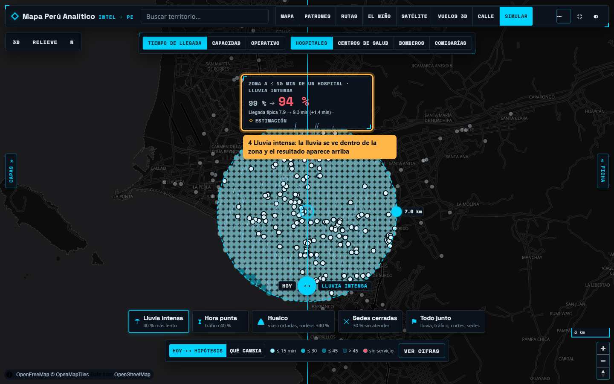

### 5 · Cambia el «¿qué pasa si…?» con una ficha
Abajo: **Lluvia intensa · Hora punta · Huaico · Sedes cerradas · Todo junto** (y **Más llamadas** en Capacidad).
Un toque y el mapa se recalcula solo. Arriba eliges el servicio: hospitales, centros de salud, bomberos o comisarías.

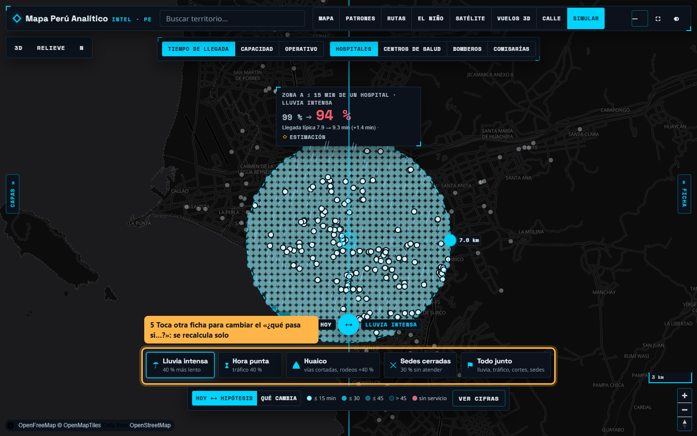

### 6 · Compara con la cortina
Arrastra el asa **⟷**: a la izquierda se pinta **HOY**, a la derecha **la hipótesis**. Colores: más claro = más rápido.

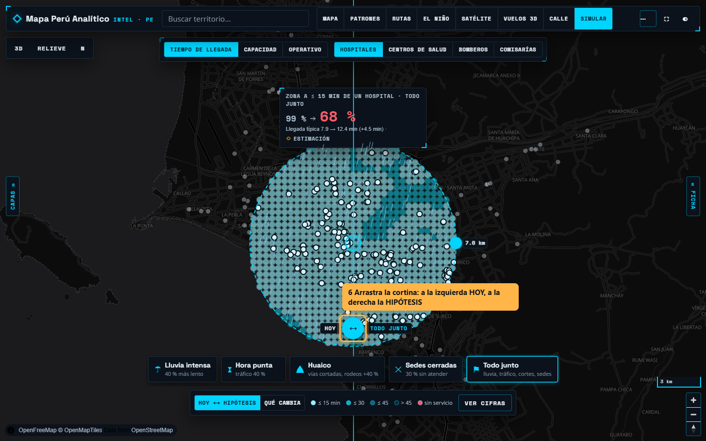

### 7 · Mira qué cambia y cierra sedes
**QUÉ CAMBIA** pinta en rojo lo que empeora, en verde lo que mejora y en gris lo que queda igual (±1 min).
Toca una sede para **cerrarla** en la hipótesis (se pone roja); tócala otra vez para reabrirla.

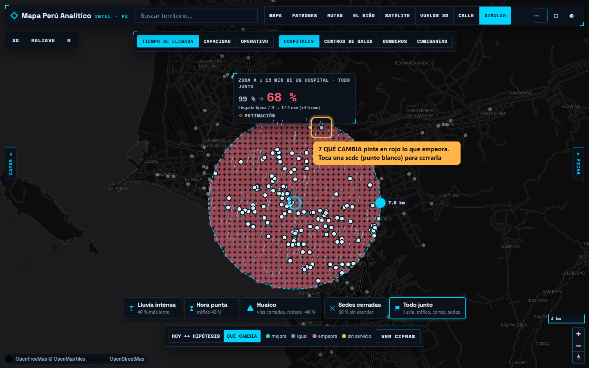

### 8 · Capacidad: colas y sedes saturadas
**CAPACIDAD** simula llamadas que llegan, se asignan a la sede libre más cercana y la ocupan un tiempo.
Las sedes se colorean por ocupación (verde < 50 %, ámbar 50–80 %, rojo ≥ 80 %) y el marcador muestra
cuántas llamadas se atienden en 30 minutos o menos.

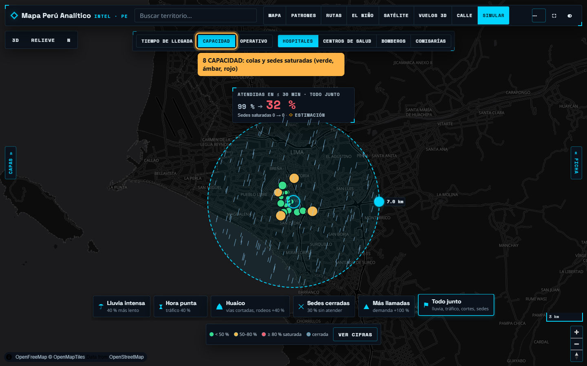

### 9 · Las cifras, solo cuando las necesitas
**VER CIFRAS** abre el panel con la tabla completa hoy / hipótesis, rangos, supuestos, fuentes, el número de ejecución,
ajustes finos (velocidad, repeticiones, semilla, llamadas por hora, unidades por sede) y las simulaciones anteriores.

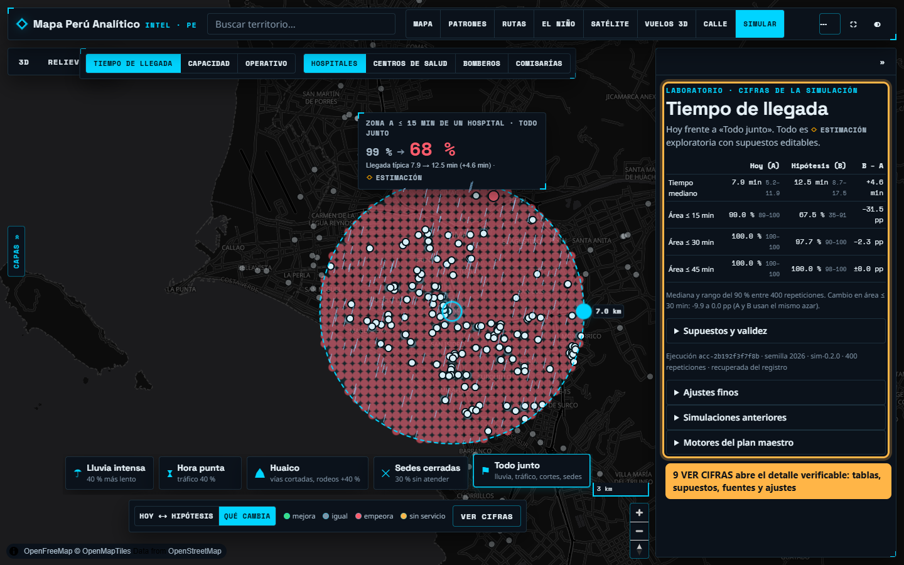

## Operativo: marcar unidades y tramos, y jugar el tiempo

### 10 · Coloca unidades
Pulsa **OPERATIVO** arriba. Elige **Patrullero, Serenazgo, Ambulancia o Bomberos** y haz clic en el mapa para colocar
cada unidad (letra P, S, A, B). **Arrástrala** para moverla; **doble clic** (o tecla Supr) la quita. Cada cambio recalcula.

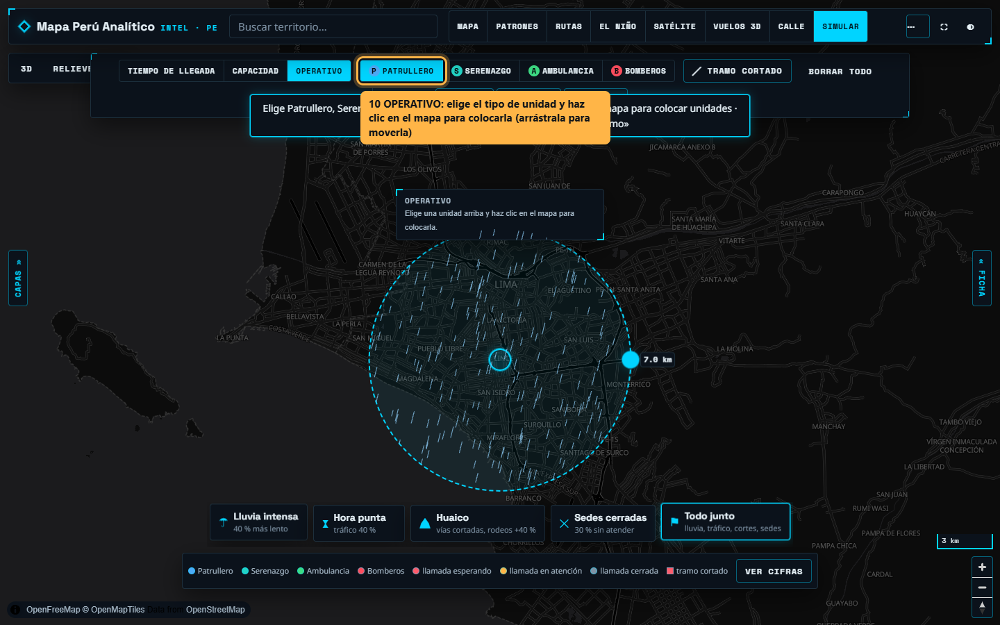

### 11 · Marca tramos cortados
**╱ TRAMO CORTADO**: haz clic punto a punto sobre la vía y pulsa **Terminar tramo** (o doble clic / Enter; Esc cancela).
Los trayectos que cruzan un tramo cortado suman un rodeo (60 % por defecto, editable en «Ver cifras»).

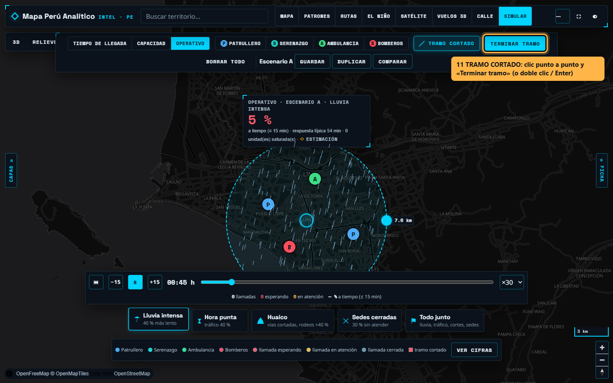

### 12 · Reproduce el tiempo virtual
Las llamadas hipotéticas aparecen en el mapa (rojo: esperando · ámbar: en atención · gris: cerrada) y las unidades
se desplazan hacia ellas y vuelven a su base. **▶ / ⏸** reproduce o pausa, **−15 / +15** retrocede o adelanta 15 minutos,
**⏮** vuelve al inicio, la **línea de tiempo** lleva a cualquier minuto y **×10 · ×30 · ×120** cambia la velocidad.
El marcador muestra el % atendido a tiempo, la respuesta típica y las unidades saturadas.

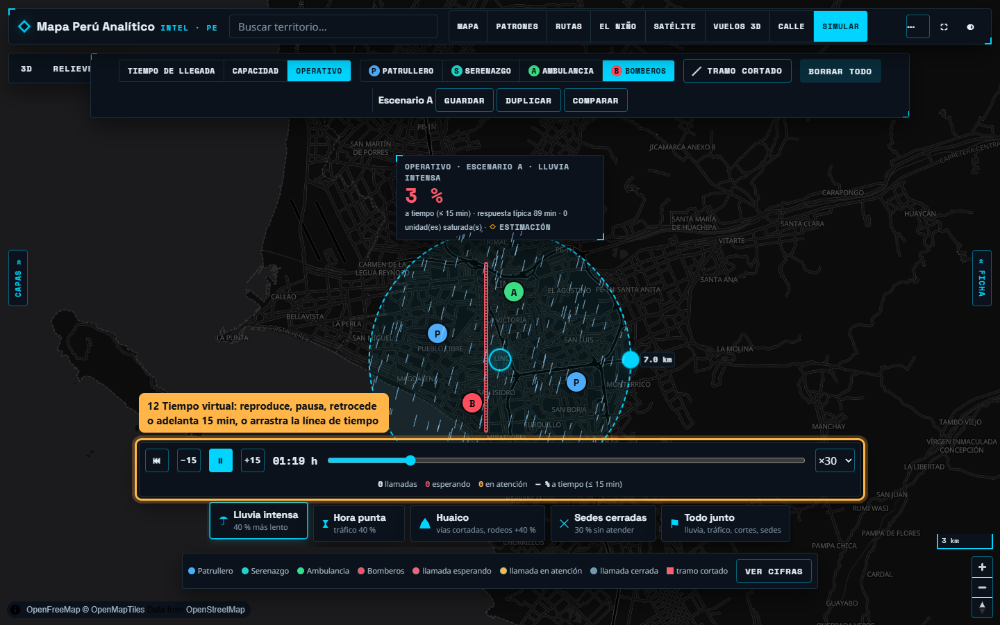

### 13 · Escenarios A, B, C…
**GUARDAR** registra el escenario (cada guardado es una versión nueva con fecha). **DUPLICAR** crea una copia
independiente (B, C…) para probar otra distribución de unidades, otros tramos u otro «¿qué pasa si…?».
**COMPARAR** abre la tabla con todos los escenarios: % a tiempo, respuesta típica, sin atender, unidades y tramos;
**Abrir** recupera cualquiera en el mapa.

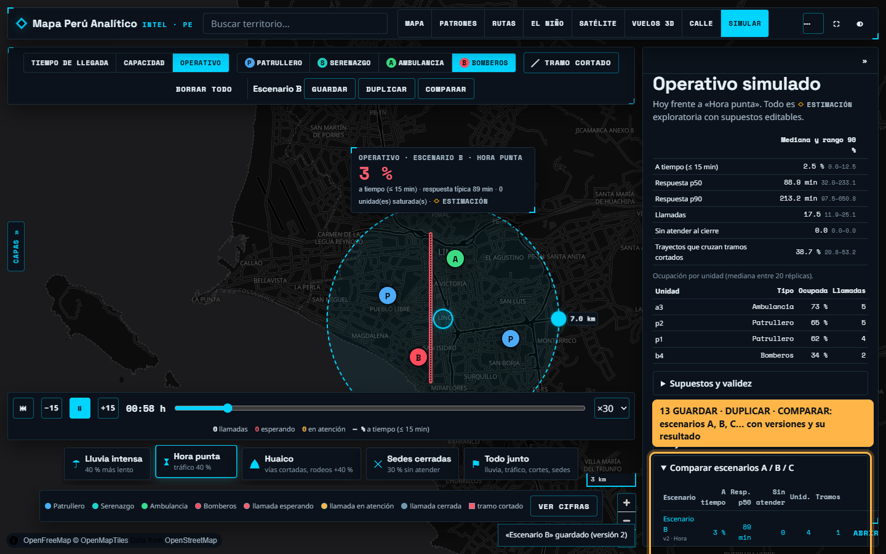

> El operativo es un **ejercicio de mesa**: las llamadas son sintéticas (tasa y mezcla declaradas, ubicadas al azar en la
> zona), no provienen de denuncias ni de personas, y el sistema no emite órdenes ni rutas sobre personas reales.

## Qué significan los resultados

- Son **estimaciones exploratorias**: distancia en línea recta × factor de rodeo, sin red vial calibrada.
- Los porcentajes son de **área** de la zona, no de población (la población solo se publica por distrito y no se reparte).
- Los escenarios son combinaciones **hipotéticas** para explorar; no están calibrados con un evento real.
- Misma zona, escenario y semilla → mismo resultado. Cada simulación queda registrada en `data/simulation/runs/`.

## Volver a generar las capturas

```bash
PLAYWRIGHT_MODULE=<ruta a playwright> node scripts/capturas_guia_simulador.mjs http://127.0.0.1:8360
```
